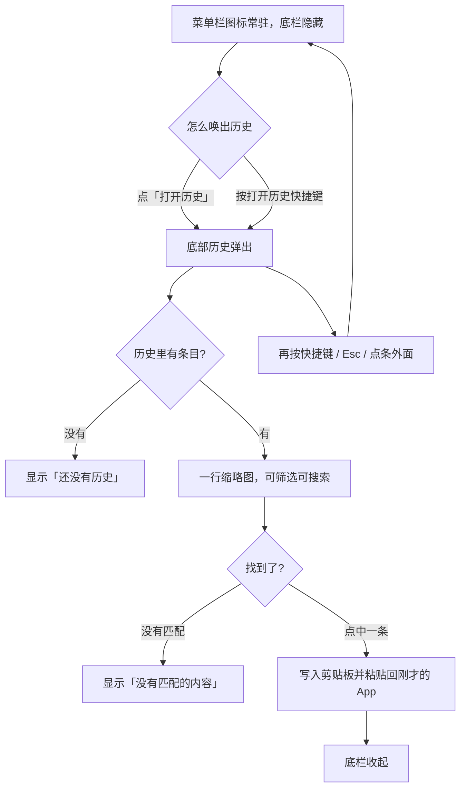
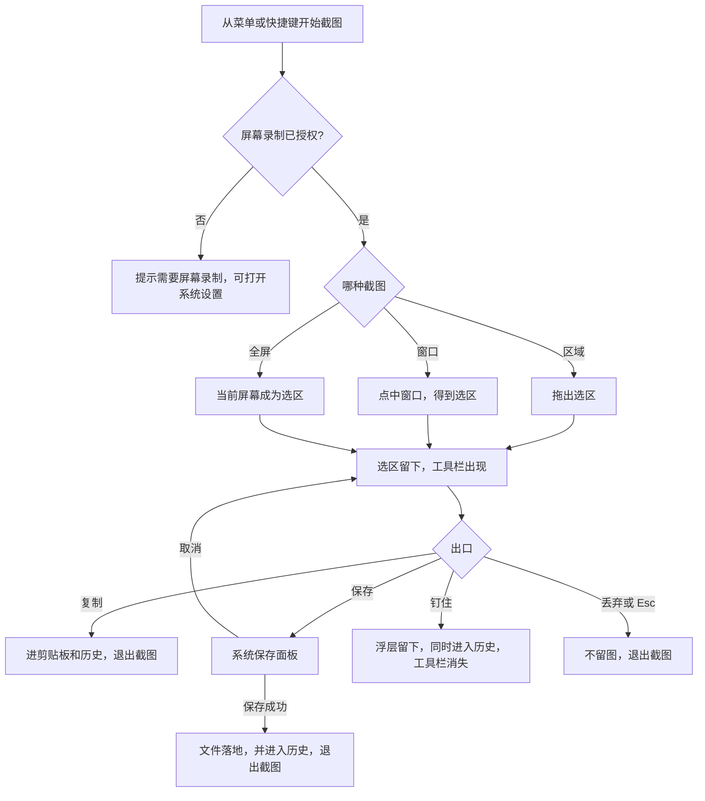
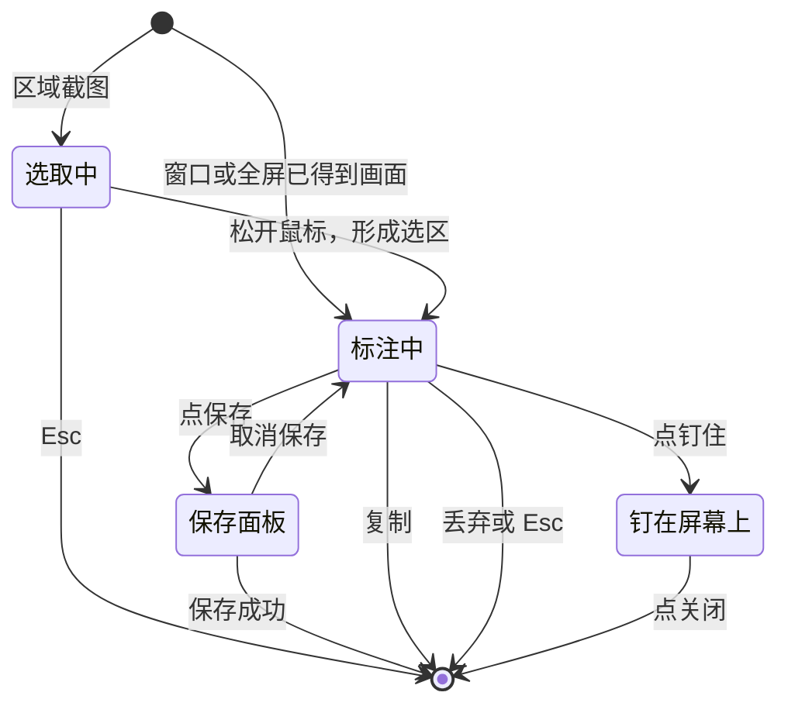
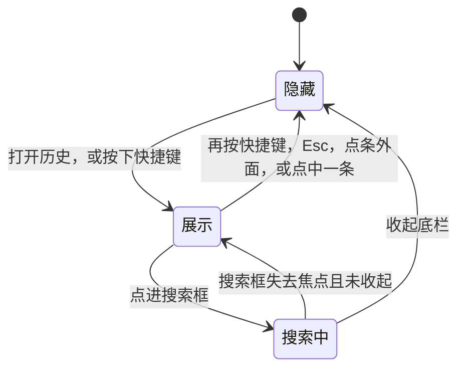
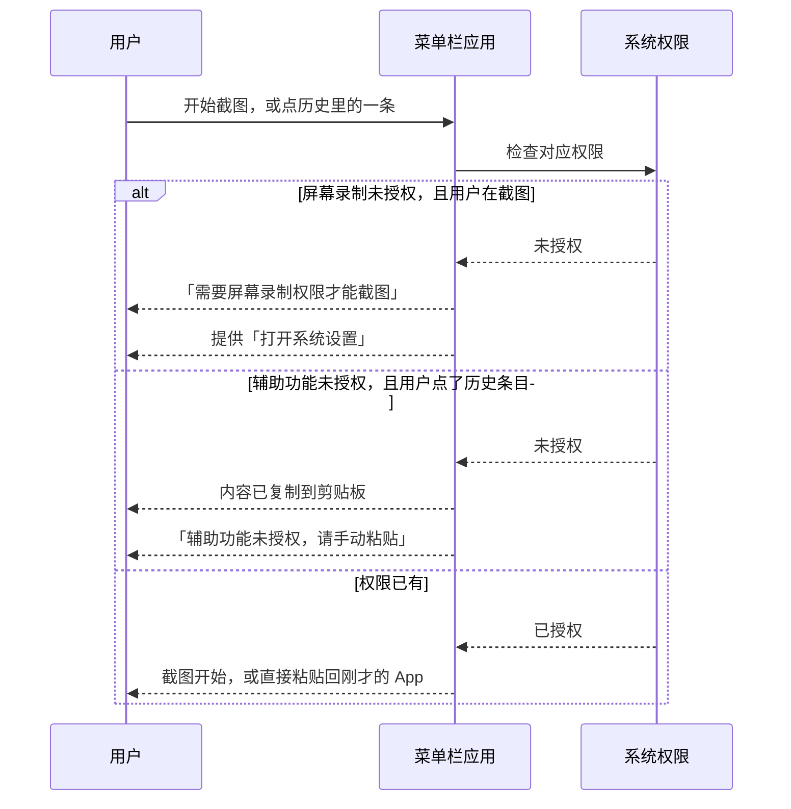

# 产品需求文档：菜单栏截图与剪贴板 - V1.0

> 标识：PRD-001
> 日期：2026-10-30
> 状态：2026-10-30 修订。快捷键可改，权限可点过去授权，底栏不提前出滚动条，钉住可拖，截图工具栏加大并改对图标。
> 设计稿：[主界面-设计稿.html](../主界面-设计稿.html)
> 读者：给自己用的 macOS 菜单栏工具。本文只写用户可见行为和验收，不写实现方案。

## 1. 综述 (Overview)

### 1.1 项目背景与核心问题

现有截图工具占空间、占内存，剪贴板又是另一个常驻工具。截完的图和以前复制的文本、图片不在同一处，过后不好找。

这个版本做一件事：一个只住在菜单栏里的 macOS 应用，平时不占屏幕；需要时唤出一条底部历史，找回以前复制的文本、图片、链接、颜色，以及自己截过的图。截图、标注、复制、保存、钉住都发生在同一次操作里，结果进同一条历史。

只给自己用。界面中文。外观跟随 macOS，不另做品牌色。截图工具栏只参考「选区下沿一条工具」的布局，不照搬任何现有产品的资源或实现。不读取 ClipDot 的数据。

### 1.2 核心业务流程 / 用户旅程地图

1. **阶段一：常驻** - 应用只以菜单栏图标存在，屏幕上没有底栏，也没有 Dock 图标。
2. **阶段二：找回** - 需要时唤出底部历史，筛选或搜索，点一条粘贴回刚才的 App。
3. **阶段三：截图** - 区域、窗口或全屏截图，在选区上标注，再选择复制、保存、钉住或丢弃。
4. **阶段四：收着** - 自己选容量上限，超了就删最早的；权限不够时说清楚，并给出去系统设置的入口。

### 1.3 Mermaid 图（流程/状态/时序）

> 说明：图只对齐用户看得见的行为，不写实现细节。

#### 1.3.1 用户操作流（必填）

找回：



截图：



#### 1.3.2 状态机（当存在明确状态流转对象时必填）

截图这一次操作的状态：



底栏的可见状态：



钉住的图关掉后，历史里的那一份还在。钉住不是历史的另一种状态。

#### 1.3.3 关键场景时序（仅当“时序/并发/重试/超时”影响用户可见结果时填写）

权限不够时，用户必须立刻看到原因，不能静默失败：



### 1.4 已确认决策与非目标

已确认，实现时不得改口：

- 独立菜单栏应用，只做 macOS，Swift 原生，只给自己用，界面中文。
- 菜单栏图标点开的是截图菜单，不是历史。历史靠「打开历史」或快捷键唤出，用完即走。
- 历史是底部一条，不是左侧或右侧竖排，也不是常驻底栏。
- 文本、图片、链接、颜色、截图进同一条历史，用筛选分开。
- 截图方式只有区域、窗口、全屏。
- 标注有箭头、矩形、椭圆、文字、马赛克、高亮，以及撤销、重做。
- 截图出口是复制、保存、钉住、丢弃。保存不在设置里指定文件夹。
- 容量档位是 50 / 100 / 200 / 500 MB / 1 GB，默认 200 MB。超过上限删最早的。
- 外观跟随系统浅色/深色，用系统字体和系统图标。

明确不做：

- 不读 ClipDot 的历史，不搬它的代码、图标或文案资源。
- 不做滚动长截图、录屏、OCR、上传、多设备同步。
- 不做置顶、收藏、标签、片段库。
- 不做文件类型的历史。剪贴板里只有文件、没有文本或图片时，不记入。
- 不做标注的颜色、粗细、字体面板。
- 不做左侧/右侧历史形态，不做请作者喝咖啡，不做语言切换。
- 不在 Dock 里出现。

## 2. 用户故事详述 (User Stories)

### 阶段一：常驻

---

#### **US-01: 作为使用者，我希望应用只以菜单栏图标常驻，以便屏幕和 Dock 都不被多占一块。**

*   **价值陈述 (Value Statement)**:
    *   **作为** 这台 Mac 的使用者
    *   **我希望** 应用启动后只在菜单栏留一个图标
    *   **以便于** 平时看不见它，需要截图或历史时再叫出来
*   **业务规则与逻辑 (Business Logic)**:
    1.  **前置条件**: 应用已启动。
    2.  **操作流程 (Happy Path)**:
        1. 启动后，Dock 里没有图标，屏幕上没有底栏、没有主窗口。
        2. 点菜单栏图标，弹出菜单，且只弹出菜单。
        3. 菜单项为：区域截图、窗口截图、全屏截图、打开历史、设置…、退出。
        4. 区域截图、窗口截图、全屏截图、打开历史的右侧显示当前快捷键。默认是 ⌘⇧1、⌘⇧2、⌘⇧3、⌘⇧V。
        5. 点「退出」后，菜单栏图标消失，底栏和钉住的图一并关掉。已写入历史的内容还在，下次启动还能看到。
    3.  **异常处理 (Error Handling)**:
        * 快捷键和系统或其他应用冲突时，设置里能改。冲突的那一项在菜单里不显示一个无效的组合，改完立即生效。
        * 开机时启动默认开启，可在设置里关掉。关掉后，本次仍继续运行，下次登录不再自动打开。
*   **验收标准 (Acceptance Criteria)**:
    *   **场景1: 启动后不占屏幕**
        *   **GIVEN** 应用已启动
        *   **WHEN** 我没有点图标，也没有按历史快捷键
        *   **THEN** 屏幕底部没有历史条，Dock 里没有这个应用的图标。
    *   **场景2: 点图标只开菜单**
        *   **GIVEN** 应用在菜单栏
        *   **WHEN** 我点菜单栏图标
        *   **THEN** 出现截图和历史的菜单，底部历史不弹出。
    *   **场景3: 退出不丢历史**
        *   **GIVEN** 历史里已有条目
        *   **WHEN** 我退出并再次启动
        *   **THEN** 那些条目还在。
---
*   **页面布局线框图 (ASCII Wireframe)**:
    ```text
    菜单栏                                          [图标]
                                              +------------------+
                                              | 区域截图   ⌘⇧1  |
                                              | 窗口截图   ⌘⇧2  |
                                              | 全屏截图   ⌘⇧3  |
                                              |------------------|
                                              | 打开历史   ⌘⇧V  |
                                              |------------------|
                                              | 设置…           |
                                              | 退出            |
                                              +------------------+
    屏幕其余部分是刚才正在用的 App。底部没有条。
    ```
---

### 阶段二：找回

---

#### **US-02: 作为使用者，我希望只在需要时唤出底部历史，以便平时屏幕是干净的。**

*   **价值陈述 (Value Statement)**:
    *   **作为** 使用者
    *   **我希望** 用点击或快捷键把历史叫出来，用完它自己走
    *   **以便于** 找回内容时不用留着一条永远占着底部的栏
*   **业务规则与逻辑 (Business Logic)**:
    1.  **前置条件**: 应用在运行。底栏当前是隐藏的。
    2.  **操作流程 (Happy Path)**:
        1. 点菜单里的「打开历史」，或按打开历史快捷键。
        2. 底栏出现在鼠标所在屏幕的底部，盖在当前 App 上面。
        3. 底栏默认不抢走焦点。当前 App 仍是刚才那个，除非我点进搜索框。
        4. 收起方式：再按一次快捷键、按 Esc、点条外面。点中一条也会收起，见 US-03。
        5. 底栏已经开着时，再点「打开历史」或再按快捷键，改为收起，不叠第二条。
    3.  **异常处理 (Error Handling)**:
        * 正在截图时按打开历史快捷键，不打断截图，不弹出底栏。截图结束前，历史保持隐藏。
        * 底栏开着时开始截图，先收起底栏，再进入截图。
*   **验收标准 (Acceptance Criteria)**:
    *   **场景1: 快捷键唤出**
        *   **GIVEN** 底栏隐藏，我正在备忘录里
        *   **WHEN** 我按下打开历史快捷键
        *   **THEN** 底部出现历史条，备忘录仍是当前 App。
    *   **场景2: 点外面收起**
        *   **GIVEN** 底栏已显示
        *   **WHEN** 我点条外面的桌面或窗口
        *   **THEN** 底栏消失，没有发生粘贴。
    *   **场景3: 截图中不插入历史**
        *   **GIVEN** 我正在框选或标注
        *   **WHEN** 我按下打开历史快捷键
        *   **THEN** 截图不被取消，底栏不出现。
---
*   **页面布局线框图 (ASCII Wireframe)**:
    ```text
    平时
    +--------------------------------------------------+
    | 菜单栏                                      [图标] |
    |                                                  |
    |              当前 App，底部空着                   |
    +--------------------------------------------------+

    唤出后
    +--------------------------------------------------+
    | 菜单栏                                      [图标] |
    |                                                  |
    |         （悬停某张图时，预览浮在条上方）          |
    | +----------------------------------------------+ |
    | | 筛选 | 条目一行……              86/200MB 搜索 | |
    | +----------------------------------------------+ |
    +--------------------------------------------------+
    ```
---

#### **US-03: 作为使用者，我希望按类型和关键字找回一条，并粘贴回刚才的 App，以便不用到别处翻。**

*   **价值陈述 (Value Statement)**:
    *   **作为** 使用者
    *   **我希望** 在一条历史里筛、搜、点选
    *   **以便于** 以前复制的文本、图片和自己截的图都能贴回去
*   **业务规则与逻辑 (Business Logic)**:
    1.  **前置条件**: 底栏已唤出。
    2.  **操作流程 (Happy Path)**:
        1. 条的左侧是筛选：全部、文本、图片、链接、颜色、截图。默认「全部」。
        2. 中间是一行条目。内容放得下时不出现滚动条，也不留一条白条。只有超出宽度才横向滚动。图片是小缩略图，文本是两行摘要，链接显示地址，颜色显示色块和色值。
        3. 条目按时间从新到旧排列。
        4. 鼠标停在图片或截图上，条上方出现这一张的大预览，并写明时间和来源。移开后预览消失。
        5. 右侧是已用容量和搜索框。容量的行为见 US-08。
        6. 点中一条：内容写入系统剪贴板，粘贴到唤出历史之前的那个 App，底栏收起。
        7. 点进搜索框后才接收键盘输入。搜索匹配文本内容、链接地址、颜色色值。清空搜索后回到当前筛选的全部结果。
    3.  **异常处理 (Error Handling)**:
        * 没有历史时，条中间显示「还没有历史」，筛选和搜索仍在，但不能点出一条。
        * 有历史但当前筛选或搜索没有结果时，显示「没有匹配的内容」。
        * 辅助功能未授权时，点一条仍写入剪贴板并收起底栏，但不自动粘贴。提示「辅助功能未授权，请手动粘贴」。设置里可去打开系统设置。
        * 预览只在鼠标停着时出现。不要把原图一直留在条上。
    4.  **类型怎么归类**:
        * 文本：普通文字。一段文字如果本身是链接，归为链接，不重复出现在文本。如果本身是颜色值，归为颜色。
        * 图片：所有图片，包含本应用截出去的图。
        * 截图：只含本应用截图产生的图。一张截图在「全部」「图片」「截图」里都能看到。
        * 只有文件、没有文本或图片的剪贴板内容，不出现。
*   **验收标准 (Acceptance Criteria)**:
    *   **场景1: 点文本即贴回**
        *   **GIVEN** 我从备忘录唤出历史，辅助功能已授权，历史里有一段文字
        *   **WHEN** 我点那一段
        *   **THEN** 这段文字贴进备忘录，底栏消失。
    *   **场景2: 筛截图**
        *   **GIVEN** 历史里既有普通图片，也有本应用截的图
        *   **WHEN** 我点「截图」
        *   **THEN** 只剩下本应用截的图。再点「图片」，普通图片和截图都在。
    *   **场景3: 搜不到**
        *   **GIVEN** 历史不为空
        *   **WHEN** 我搜索一个不存在的词
        *   **THEN** 显示「没有匹配的内容」，底栏不收起。
    *   **场景4: 不能自动粘贴**
        *   **GIVEN** 辅助功能未授权
        *   **WHEN** 我点一条
        *   **THEN** 剪贴板里已是这一条，并提示我手动粘贴，底栏收起。
---
*   **页面布局线框图 (ASCII Wireframe)**:
    ```text
    +------------------------------------------------------------------+
    | 全部  文本                                                     |
    | 图片  链接   [图] [文本两行……] [图] [链接] [色块]   86/200MB [搜索] |
    | 颜色  截图                                                     |
    +------------------------------------------------------------------+
              ^ 悬停时，预览出现在这条的上方，不把条撑高

    空：
    +------------------------------------------------------------------+
    | 筛选仍在                                          0/200MB [搜索] |
    |                    还没有历史                                    |
    +------------------------------------------------------------------+

    无结果：
    +------------------------------------------------------------------+
    | 筛选仍在                                          86/200MB [搜索] |
    |                  没有匹配的内容                                  |
    +------------------------------------------------------------------+
    ```
---

#### **US-04: 作为使用者，我希望复制过的文本、图片、链接和颜色被记下来，以便过后还能找到。**

*   **价值陈述 (Value Statement)**:
    *   **作为** 使用者
    *   **我希望** 应用在背后记住我复制的内容
    *   **以便于** 不需要我额外按一个「保存到历史」
*   **业务规则与逻辑 (Business Logic)**:
    1.  **前置条件**: 应用在运行。
    2.  **操作流程 (Happy Path)**:
        1. 我在任意 App 里复制文本、图片、链接或颜色。
        2. 应用把它记入历史，新的在最前。
        3. 和上一条内容完全相同的，不重复记一条，只把已有那条移到最前，并更新时间。
        4. 本应用自己的截图在复制、保存成功或钉住时记入，并带上「截图」标记。见 US-07。
        5. 数据只留在这个应用自己的沙盒里。退出再开，历史还在。
    3.  **异常处理 (Error Handling)**:
        * 内容超过当前容量上限时，按 US-08 处理。单条本身就放不下时，不记入，并提示。
        * 复制一段空内容，不记入。
        * 只有文件的剪贴板，不记入。
        * 应用没运行时发生的复制，不补记。
*   **验收标准 (Acceptance Criteria)**:
    *   **场景1: 复制后能找到**
        *   **GIVEN** 应用在运行
        *   **WHEN** 我在备忘录复制一句「明天下午三点，会议室 B」
        *   **THEN** 唤出历史后，这句话在最前，类型归在文本。
    *   **场景2: 相同内容不重复堆**
        *   **GIVEN** 这句话已经在历史里
        *   **WHEN** 我再次复制同一句
        *   **THEN** 历史里仍只有一条，它回到最前。
    *   **场景3: 重启还在**
        *   **GIVEN** 历史里已有条目
        *   **WHEN** 我退出并重新打开应用
        *   **THEN** 条目还在，顺序不变。
---

### 阶段三：截图

---

#### **US-05: 作为使用者，我希望用区域、窗口或全屏截下当前屏幕，以便不用换一个更重的截图工具。**

*   **价值陈述 (Value Statement)**:
    *   **作为** 使用者
    *   **我希望** 从菜单或快捷键开始三种截图
    *   **以便于** 框一块、点一个窗口，或截下整屏
*   **业务规则与逻辑 (Business Logic)**:
    1.  **前置条件**: 屏幕录制已授权。未授权时的表现见 US-09。
    2.  **操作流程 (Happy Path)**:
        1. 区域截图：屏幕变暗。点下去时不出现亮框。拖出矩形后才有细线选区。松开后选区留下。四条边和四个角都能拖，拖多少变多少，不能一动就缩成很小。未选工具时拖动选区内部可以移动它。选区旁显示宽高。
        2. 窗口截图：点一下真正的窗口，该窗口成为选区，不需要拖框，也不预先画亮框。不选程序坞、菜单栏、自己的遮罩。点程序坞或菜单栏不算选中窗口。
        3. 全屏截图：鼠标所在的那一块屏幕成为选区，不拖框。工具栏改浮在该屏幕底部居中，避免画到屏幕外。
        4. 区域和窗口的工具栏贴在选区下沿。选区靠近屏幕底边、贴不下时，工具栏改到选区上沿。
        5. 三种方式进入的是同一套标注和同一套出口。
        6. 选取过程中按 Esc，取消这次截图，不产生历史。
    3.  **异常处理 (Error Handling)**:
        * 区域截图拖得太小，松手后不成选区，仍停留在选取中，可以再拖。
        * 多块屏幕时，只处理鼠标所在的那一块，不把所有屏幕拼成一张。
        * 截图过程中，底栏保持隐藏。
*   **验收标准 (Acceptance Criteria)**:
    *   **场景1: 区域截图留下选区**
        *   **GIVEN** 屏幕录制已授权
        *   **WHEN** 我按区域截图快捷键并拖出一个矩形
        *   **THEN** 选区留下，下面有工具栏，还没有写入历史。
    *   **场景2: 窗口截图不拖框，也不截程序坞**
        *   **GIVEN** 屏幕上有一个窗口，底部是程序坞
        *   **WHEN** 我开始窗口截图并点这个窗口
        *   **THEN** 选区就是这个窗口，不包含程序坞和顶部菜单栏，点击前没有亮框。
    *   **场景3: 全屏工具栏不跑出屏幕**
        *   **GIVEN** 我开始全屏截图
        *   **WHEN** 画面已经截下
        *   **THEN** 工具栏在当前屏幕底部居中，整屏是选区。
    *   **场景4: Esc 取消**
        *   **GIVEN** 我正在选取或标注
        *   **WHEN** 我按 Esc
        *   **THEN** 截图消失，历史条数不变。
---
*   **页面布局线框图 (ASCII Wireframe)**:
    ```text
    区域 / 窗口
    +------------------------------------------+
    |  560 × 300                               |
    |  +------------------------------+        |
    |  |           选区               |        |
    |  +------------------------------+        |
    |  [箭头][矩形][椭圆][T][马赛克][高亮] | [撤销][重做] | [复制][保存][钉住][丢弃]
    +------------------------------------------+

    全屏
    +------------------------------------------+
    |                                          |
    |              整屏就是选区                 |
    |                                          |
    |     [工具栏浮在这块屏幕底部居中]          |
    +------------------------------------------+
    ```
---

#### **US-06: 作为使用者，我希望在选区上标注并打马赛克，以便图发出去之前能改。**

*   **价值陈述 (Value Statement)**:
    *   **作为** 使用者
    *   **我希望** 在已经截下的选区上画箭头、框、字、马赛克和高亮
    *   **以便于** 标出重点，并挡住不该露出的内容
*   **业务规则与逻辑 (Business Logic)**:
    1.  **前置条件**: 已进入标注，工具栏可见。
    2.  **操作流程 (Happy Path)**:
        1. 进入标注时不预选工具，以便还能改选区大小和位置。
        2. 点一个工具后，它成为当前工具。再点同一个工具，取消选择。
        3. 工具栏按钮要大到好点，并且图标下面写中文：箭头、矩形、椭圆、文字、马赛克、高亮。箭头画出来必须有箭头，不是一根直线。文字按钮点下去出现能打字的输入框，按 Esc 结束这一笔。高亮是半透明色块，不是铅笔。马赛克图标是格子。马赛克画笔大小用滑块调节，不另开窗口。
        4. 颜色只有五个色块：红、蓝、黑、黄、白。点色块就换色，不弹出取色器。箭头、矩形、椭圆、文字、高亮使用当前颜色。没有字体面板。
        5. 撤销去掉最近一笔，重做恢复刚撤销的一笔。没有可撤销的笔时，撤销不可用。没有可重做的笔时，重做不可用。
        6. 标注先留在选区上。只有点了复制、保存或钉住，才合成一张图。撤销不产生中间图。
    3.  **异常处理 (Error Handling)**:
        * 文字没输入就点外面，这一笔不留下。
        * 拖拽距离短到看不出形状，这一笔不留下。
        * 合成时如果写不下历史，按 US-08 提示，并留在标注里，不退出，已画的笔还在。
*   **验收标准 (Acceptance Criteria)**:
    *   **场景1: 马赛克挡住内容**
        *   **GIVEN** 选区里有一行手机号
        *   **WHEN** 我用马赛克涂过这行，再点复制
        *   **THEN** 贴出去的图上，这行不可读。历史里的也是这张打过码的图。
    *   **场景2: 撤销一笔**
        *   **GIVEN** 我刚画了一个箭头
        *   **WHEN** 我点撤销
        *   **THEN** 箭头消失。再点重做，箭头回来。
    *   **场景3: 未选工具时还能改选区**
        *   **GIVEN** 没有工具被选中
        *   **WHEN** 我拖选区的角
        *   **THEN** 选区大小改变，没有画出一笔。
---
*   **页面布局线框图 (ASCII Wireframe)**:
    ```text
    +----------------------------------+
    | 选区                        [角] |
    |     ~~~~ 马赛克盖住手机号 ~~~~   |
    |                          [角]    |
    +----------------------------------+
    [箭头][矩形][椭圆][T][马赛克*][高亮] | [撤销][重做] | [复制][保存][钉住][×]
    * 表示当前工具
    ```
---

#### **US-07: 作为使用者，我希望截完后复制、当场保存、钉住或丢弃，以便一张图有明确的去处。**

*   **价值陈述 (Value Statement)**:
    *   **作为** 使用者
    *   **我希望** 在工具栏上结束这次截图
    *   **以便于** 贴走、留一份文件、钉在屏幕上，或者当没截过
*   **业务规则与逻辑 (Business Logic)**:
    1.  **前置条件**: 处于标注中。可以一笔都没画。
    2.  **操作流程 (Happy Path)**:
        1. 复制：合成后的图写入剪贴板，并作为截图进入历史，然后退出截图。
        2. 保存：先把截图层让开，再弹出系统保存面板，避免面板被截图挡住无法点击。默认文件名包含日期和时间，我可以改文件名和位置。保存成功后，文件落地，同一张图进入历史，然后退出截图。取消则回到刚才的标注。没有设置项来记住默认文件夹。
        3. 钉住：同一张图进入历史，工具栏和选区遮罩消失，屏幕上留下浮层，浮在最前，右上角有关闭。按住图的任意空白处可以拖到屏幕任何位置。关掉浮层不删除历史里的那一份。
        4. 丢弃：不写文件，不进剪贴板，不进历史，退出截图。Esc 与丢弃相同。
    3.  **异常处理 (Error Handling)**:
        * 在保存面板点取消，回到标注，已画的笔还在，历史不变。
        * 保存失败时，留在标注，提示「没有保存」，历史不变。
        * 这一张图大于容量上限时，复制、保存、钉住都不把它写入历史。复制仍把图放进剪贴板。保存仍可把文件写到我选的位置。钉住仍可留下浮层。同时提示「这一张超过容量上限，没有放入历史」。
        * 同时只钉住一张。已经钉着一张时再钉新的，旧浮层关掉，历史里两张都还在。关掉浮层就释放这张正在显示的图。
*   **验收标准 (Acceptance Criteria)**:
    *   **场景1: 复制进历史**
        *   **GIVEN** 我完成了一次区域截图
        *   **WHEN** 我点复制
        *   **THEN** 剪贴板是这张图，历史最前多了一条截图，截图界面消失。
    *   **场景2: 保存不依赖设置里的文件夹**
        *   **GIVEN** 我在标注中
        *   **WHEN** 我点保存
        *   **THEN** 出现系统保存面板，由我选择位置。设置里没有「截图另存到」。
    *   **场景3: 取消保存不退出**
        *   **GIVEN** 系统保存面板已打开
        *   **WHEN** 我取消
        *   **THEN** 回到刚才的选区和工具栏，历史没有新条目。
    *   **场景4: 钉住后还能在历史里找到**
        *   **GIVEN** 我点了钉住
        *   **WHEN** 我关掉浮层，再唤出历史并筛选「截图」
        *   **THEN** 这张图还在。
    *   **场景5: 丢弃不留**
        *   **GIVEN** 我在标注中，历史有 3 条
        *   **WHEN** 我点丢弃
        *   **THEN** 截图界面消失，历史仍是 3 条，剪贴板不是这张新图。
---
*   **页面布局线框图 (ASCII Wireframe)**:
    ```text
    工具栏出口
    [箭头][矩形][椭圆][T][马赛克][高亮] | [撤销][重做] | [复制][保存][钉住][丢弃]

    保存
    +---------------------------+
    | 存储为                    |
    | 名称  截图 2026-10-30 ….  |
    | 位置  [由我当场选择]      |
    |        [取消]  [存储]     |
    +---------------------------+

    钉住后
    +---------------------------+
    |                        ×  |
    |         浮着的图          |
    +---------------------------+
    可拖动。没有工具栏。关掉不删历史。
    ```
---

### 阶段四：收着

---

#### **US-08: 作为使用者，我希望自己选一个容量上限，超了就删最早的，以便历史不会无限占磁盘。**

*   **价值陈述 (Value Statement)**:
    *   **作为** 使用者
    *   **我希望** 看见已经用了多少，并在固定档位里选上限
    *   **以便于** 新东西放得进去，旧东西按时间让位
*   **业务规则与逻辑 (Business Logic)**:
    1.  **前置条件**: 应用在运行。
    2.  **操作流程 (Happy Path)**:
        1. 档位只有 50 MB、100 MB、200 MB、500 MB、1 GB。默认 200 MB。
        2. 底栏右侧显示「已用 / 上限」，例如 86 / 200 MB。点这个数字打开设置，不在条上直接改，避免误触。
        3. 设置的存储区有同样的档位、已用进度，以及说明：「超过上限后，按时间从最早的条目开始删除，腾出足够空间再放入新的。单条大于上限时不写入。」
        4. 新条目放进去会超过上限时，从最早的开始删，直到放得下，再放入新的。被删的没有回收站。
        5. 我把上限改小，而且当前已用已经超过新上限时，立刻从最早的开始删，直到已用不超过新上限。
    3.  **异常处理 (Error Handling)**:
        * 单条本身大于上限：不写入历史，不为了它把旧条目删光。提示「这一张超过容量上限，没有放入历史」。
        * 已用显示和真实占用一致。删掉条目后，数字下降。
        * 没有条目时显示 0 / 当前上限。
*   **验收标准 (Acceptance Criteria)**:
    *   **场景1: 超过上限删最早的**
        *   **GIVEN** 上限 200 MB，已用 190 MB，最早一条是一张 30 MB 的图
        *   **WHEN** 我复制一张 20 MB 的新图
        *   **THEN** 最早那条被删，新图在历史最前，已用不超过 200 MB。
    *   **场景2: 单条太大**
        *   **GIVEN** 上限 50 MB
        *   **WHEN** 我复制一张 80 MB 的图
        *   **THEN** 历史不变，并提示没有放入历史。
    *   **场景3: 改小上限会立刻清理**
        *   **GIVEN** 已用 180 MB，上限 200 MB
        *   **WHEN** 我把上限改成 100 MB
        *   **THEN** 最早的条目被删，直到已用不超过 100 MB。
    *   **场景4: 条上不能直接改档位**
        *   **GIVEN** 底栏已打开
        *   **WHEN** 我点「86 / 200 MB」
        *   **THEN** 打开设置里的容量档位，底栏上的数字本身不是一个切换器。
---
*   **页面布局线框图 (ASCII Wireframe)**:
    ```text
    底栏右侧
    86 / 200 MB
    [=====>          ]  [搜索]
    点数字 -> 打开设置

    设置 · 存储
    +--------------------------------------------------+
    | 最大占用   [50] [100] [200] [500] [1 GB]         |
    | 已用 86 MB ==================          上限 200 MB |
    | 超过上限后，按时间从最早的条目开始删除，          |
    | 腾出足够空间再放入新的。单条大于上限时不写入。    |
    +--------------------------------------------------+
    没有「截图另存到」。
    ```
---

#### **US-09: 作为使用者，我希望在设置里看见快捷键和权限，以便知道为什么截图或粘贴没有发生。**

*   **价值陈述 (Value Statement)**:
    *   **作为** 使用者
    *   **我希望** 一个小设置窗口告诉我开关、快捷键和两项权限
    *   **以便于** 出问题时知道去系统设置的哪里开
*   **业务规则与逻辑 (Business Logic)**:
    1.  **前置条件**: 从菜单点「设置…」，或从底栏的容量数字进入。
    2.  **操作流程 (Happy Path)**:
        1. 通用：开机时启动，开关。
        2. 快捷键单独一区。每一项右侧是当前组合，点它再按下新组合就改掉，菜单和全局快捷键同时更新。Esc 取消这次修改。默认仍是 ⌘⇧1、⌘⇧2、⌘⇧3、⌘⇧V，但不是写死的。
        3. 存储：只有容量档位和已用，见 US-08。没有保存位置。
        4. 权限：屏幕录制、辅助功能各自显示「已授权」或「未授权」，并各有「去授权」。点下去直接打开系统设置里对应的开关。
    3.  **异常处理 (Error Handling)**:
        * 屏幕录制未授权时，三个截图入口仍可点。点了不进入截图。系统先把本应用登记进「屏幕录制」列表。对话框说明：开关拨开后，必须完全退出并重新打开，正在运行的进程拿不到这项权限。按钮是「退出并重新打开」和「去系统设置」。辅助功能未授权时，点历史条目会复制成功，对话框里可以去授权或退出重开。
        * 屏幕录制开关打开后，必须退出并重新打开，这次运行才会变成已授权。辅助功能多数情况下回来就能用；如果仍不行，同样退出重开。
        * 快捷键改成系统已占用的组合时，不保存这一次修改，提示「这个快捷键不能用」。
*   **验收标准 (Acceptance Criteria)**:
    *   **场景1: 未授权不能静默失败**
        *   **GIVEN** 屏幕录制未授权
        *   **WHEN** 我点「区域截图」
        *   **THEN** 不进入截图，我能看到原因，并能打开系统设置。
    *   **场景2: 授权后不用重启**
        *   **GIVEN** 我刚在系统设置里允许了屏幕录制
        *   **WHEN** 我回到应用再点区域截图
        *   **THEN** 截图开始。
    *   **场景3: 设置里没有保存文件夹**
        *   **GIVEN** 我打开设置
        *   **WHEN** 我查看存储区
        *   **THEN** 只有容量档位和已用，没有「截图另存到」。
---
*   **页面布局线框图 (ASCII Wireframe)**:
    ```text
    +----------------------------------------------+
    |  ● ● ●              设置                     |
    |  通用                                        |
    |  开机时启动                          [开]    |
    |  快捷键  点右侧按钮后按下新组合              |
    |  打开历史                        [ ⌘⇧V ]      |
    |  区域截图                        [ ⌘⇧1 ]      |
    |  存储                                        |
    |  最大占用        [50][100][200][500][1 GB]   |
    |  权限                                        |
    |  屏幕录制              未授权    [去授权]    |
    |  辅助功能              未授权    [去授权]    |
    +----------------------------------------------+
    ```
---
